# CAN 주행 로그 기반 급제동 탐지 서비스

차량 센서 기록(CAN) 파일을 올리면, 직접 학습한 머신러닝 모델이 그 주행에 급감속·급정지가 있었을 확률을 알려주는 웹 서비스입니다.

## 0. 프로젝트 정보

| 항목 | 내용 |
|---|---|
| 학번 · 이름 | 202434964 · 박범근 |
| 데모 URL | https://hard-braking-detector.onrender.com |
| GitHub URL | https://github.com/bumgeum01-stack/hard-braking-detector |
| 과목 | 머신러닝 프로그래밍 기말 프로젝트 |
| 최종 모델 | Random Forest (Test F1 0.933, 운전자 단위 교차검증 F1 0.815) |

> 데모는 무료 서버라 15분쯤 쓰지 않으면 잠듭니다. 처음 접속할 때 화면이 뜨기까지 1분쯤 걸릴 수 있습니다.

## 1. 문제 정의

### 4W

| 구분 | 내용 |
|---|---|
| Who | 자신의 운전 습관을 점검하려는 운전자, 소속 운전자의 주행 기록을 검토하는 안전 교육·차량 관리 담당자 |
| What | 2분 안팎의 주행 클립 하나에 급제동(급감속 또는 급정지)이 있었는지를 CAN 센서 기록만으로 판정 |
| When | 주행이 끝난 뒤 기록 파일을 검토할 때 |
| Why | 급제동은 전방 주시 태만이나 안전거리 미확보의 결과로 나타나는 대표적인 위험 운전 신호다. 사람이 영상을 일일이 돌려보지 않고도 "어느 주행의 어느 순간을 다시 봐야 하는지"를 빠르게 골라낼 수 있다 |

### 기존 서비스 대비 차별점

- 내비게이션 앱이나 보험사의 운전 점수는 주로 스마트폰 GPS·가속도계 값이 고정 기준을 넘는지로 급감속을 셉니다. 이 프로젝트는 **차량 자체의 CAN 신호(속도, 브레이크 압력, 엔진 회전수)** 를 쓰고, 기준을 사람이 정하는 대신 **사람이 표기한 급제동 사례로 모델을 학습**시켰습니다.
- 감속도 하나만 보지 않고 브레이크 압력이 얼마나 빨리, 얼마나 오래 올랐는지를 함께 봅니다. 그래서 "감속은 컸지만 브레이크는 거의 안 밟은 경우"와 "세게 밟은 급제동"을 구분합니다.
- 결과를 점수 하나로 끝내지 않고, **가장 세게 감속한 순간을 속도·브레이크 그래프 위에 표시**해 근거를 보여줍니다.
- 모델의 한계(학습 범위, 약한 유형)를 서비스 화면에 그대로 적었습니다.

### 정량 목표

| 지표 | 목표 | 결과 |
|---|---|---|
| Test F1 (급제동 클래스) | 0.80 이상 | **0.933 (달성)** |

## 2. 데이터

### 출처 · 라이선스

| 항목 | 내용 |
|---|---|
| 데이터셋 | AI Hub 「사고위험 환경에서의 운전습관 데이터」 (2024) |
| 주소 | https://www.aihub.or.kr/aihubdata/data/view.do?currMenu=115&topMenu=100&dataSetSn=71851 |
| 구축 기관 | 에이아이웍스(주관), 소다시스템, 한국도로교통공단, 한국자동차연구원 |
| 라이선스 | AI Hub 이용약관 및 데이터 이용정책을 따릅니다. 회원 가입 후 승인을 받아 내려받았으며(내국인 한정), 원본 데이터와 그 데이터에서 만든 표는 이 저장소에 포함하지 않았습니다. |

### 규모 · 구성

- 전체 데이터셋: 3,300세트, 111시간 (운전자 영상, 주행 환경 영상, CAN 센서, 문장 라벨)
- 이 프로젝트에서 사용한 것: Training 분할의 **CAN 센서 JSON 2,640개와 문장 라벨 JSON 2,640개**
- CAN 파일 하나는 약 2분 주행이며 초당 약 30프레임으로 속도, RPM, 브레이크, 브레이크 압력 등을 기록합니다.
- 운전자는 28명입니다.

| 구간 | 클립 수 | 수집 환경 |
|---|---|---|
| 사고위험구간 | 1,347 | 실제 도로 |
| 사고다발구간 | 963 | 실제 도로 |
| 기타구간 | 7 | 실제 도로 |
| 차대차 및 차량단독 | 244 | 테스트 도로 |
| 차대사람 및 차대자전거 | 79 | 테스트 도로 |

### 정답과 클래스 분포

라벨 JSON의 요약 문장에서 "차는 급감속한 적이 있다" 같은 표현을 찾아 거동 종류를 뽑았습니다. "앞차는 급감속 중이다"처럼 앞차 이야기인 문장은 제외했습니다.

| 수집 환경 | 일반 | 급감속 | 급정지 | 급출발 | 급가속 |
|---|---|---|---|---|---|
| 실제 도로 (2,317) | 2,317 | 0 | 0 | 0 | 0 |
| 테스트 도로 (323) | 152 | 82 | 38 | 45 | 6 |

급거동 표기는 테스트 도로 클립에만 있습니다. 그래서 **학습과 평가에는 테스트 도로 323개 클립(운전자 14명)만** 썼습니다.

| 클래스 | 정의 | 클립 수 | 비율 |
|---|---|---|---|
| 1 (급제동) | 급감속 또는 급정지 | 120 | 37.2% |
| 0 (급제동 없음) | 일반, 급출발, 급가속 | 203 | 62.8% |

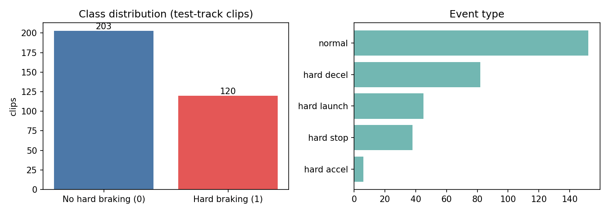

### 선정 이유

- **정답이 사람 손으로 표기돼 있습니다.** 운전 데이터는 많지만 "이 주행에 급제동이 있었다"는 표기가 붙은 공개 데이터는 드뭅니다.
- **차량 CAN 신호가 그대로 들어 있습니다.** 스마트폰 센서가 아니라 브레이크 압력처럼 제동을 직접 보여주는 신호를 쓸 수 있습니다.
- **운전자 ID가 있습니다.** 같은 사람의 클립이 학습과 평가에 섞이지 않게 나눌 수 있어, 처음 보는 운전자에 대한 성능을 정직하게 잴 수 있습니다.
- **정답이 없는 실제 도로 주행 2,317개가 함께 들어 있습니다.** 모델이 엉뚱한 단서를 배웠는지 점검하는 데 썼습니다(5장).
- 처음에는 "운전 습관으로 미래 사고 확률 예측"을 하려 했으나, 데이터를 열어보니 사고 여부 정답이 없었습니다. 정답이 실제로 존재하는 문제로 주제를 바꿨습니다.

## 3. 데이터 전처리

전처리 5가지를 코드로 구현했습니다. 모든 코드는 [`notebooks/hard_braking_colab.ipynb`](notebooks/hard_braking_colab.ipynb) 4~6장에 있고, 서비스도 같은 함수([`app/features.py`](app/features.py))를 씁니다.

| # | 기법 | 이유 | 전 | 후 |
|---|---|---|---|---|
| ① | 불량·불필요 컬럼 제거 | 가속도·자이로 센서 값이 깨져 있었고(-4088, 65399 같은 값 혼재), 조향각·요레이트는 전부 0 | 후보 신호 13개 | 4개 (속도, RPM, 브레이크, 브레이크 압력) |
| ② | 리샘플링 (30Hz → 1Hz·5Hz) | 같은 시각에 중복 기록된 프레임이 많아 일정한 시간 간격으로 정리 | 1,119,343행 (클립당 3,579행) | 37,578행 (클립당 120행) |
| ③ | 결측 보간 + 이상치 처리 | 기록이 끊긴 구간과 GPS가 늦게 잡혀 속도가 0에서 갑자기 튀는 구간이 가짜 급가속을 만듦 | 결측 50초(3개 클립), 물리 한계 초과 1개 클립. 해당 클립 최대 가속 29.6km/h/s | 결측 0초, 23초 보정. 최대 가속 5.2km/h/s |
| ④ | 특징 생성 | 길이가 제각각인 시계열을 모델이 쓸 수 있는 숫자 요약으로 변환 | 약 120초 시계열 | 제동 세기 특징 19개 |
| ⑤ | 표준화 | 단위가 다른 특징의 크기를 맞춤 (Train에만 fit) | 예: `bp_max` 평균 134.71, 표준편차 76.80 | 평균 0.0, 표준편차 1.0 |

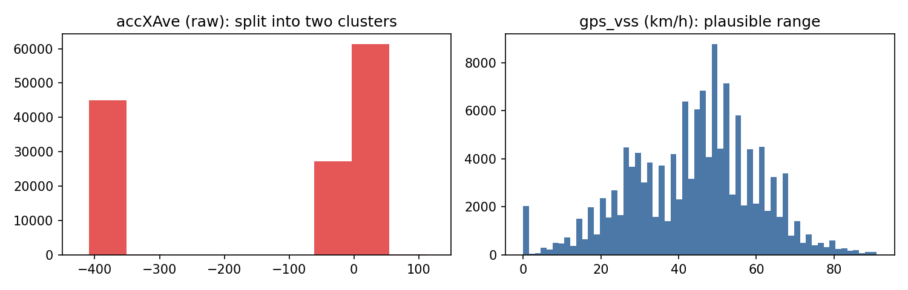

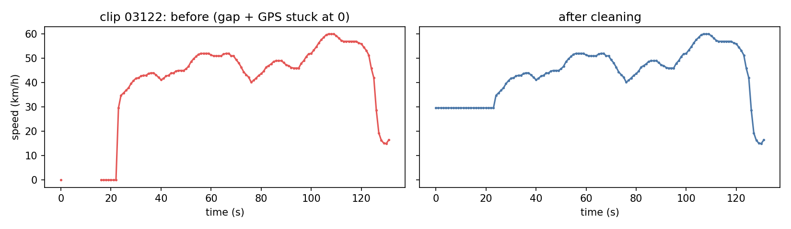

**특징 19개**는 감속 세기(1초·2초·0.6초 구간 최대 감속 등 7개), 브레이크 압력(최댓값, 0.2초·0.6초 상승폭, 압력 100·150 이상 유지 시간 등 7개), 가장 센 제동 구간(줄인 속도, 평균 감속, 최대 압력, 시작 속도 4개), 엔진 회전수 급락 1개입니다. 위치, 날짜, 평균 속도, 정지 비율처럼 운전 방식이 아니라 주행 환경을 나타내는 값은 넣지 않았습니다.

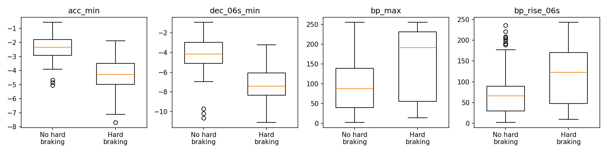

### 분할

| 세트 | 클립 | 급제동 | 운전자 | 비율 |
|---|---|---|---|---|
| Train | 192 | 72 | 7명 | 59.4% |
| Validation | 65 | 25 | 4명 | 20.1% |
| Test | 66 | 23 | 3명 | 20.4% |

- **운전자 단위 분할**입니다. 세 세트에 겹치는 운전자는 0명입니다.
- 목표 비율 60/20/20. 클립이 많은 운전자부터 차례로, 목표 클립 수에서 가장 많이 모자란 세트에 배정했습니다. 클립 수가 같은 운전자끼리의 순서는 **seed 42** 난수로 정했습니다.
- 직접 구현한 방식이라 라이브러리 버전이 달라도 같은 분할이 나옵니다.
- Test 세트는 모델 선택에 쓰지 않았습니다.

## 4. 모델

세 모델 모두 사전 학습 없이 **처음부터(Scratch) 직접 학습**했습니다. 특징 19개짜리 표 데이터에는 가져다 쓸 사전 학습 모델이 없고, 수백 개 규모에는 고전적 머신러닝이 맞기 때문입니다.

| 구분 | 모델 | 선정 이유 | 선택된 하이퍼파라미터 |
|---|---|---|---|
| 베이스라인 | Logistic Regression | 가장 단순한 선형 모델로 기준선을 잡음 | C=10 |
| 제안 1 | Random Forest | "감속이 크고 브레이크 압력도 높다" 같은 조건 조합을 스스로 찾음 | 트리 300개, max_depth=None, min_samples_leaf=3 |
| 제안 2 | Gradient Boosting | 앞 트리의 오류를 다음 트리가 고쳐 나가며, 반복마다 손실을 기록해 학습곡선을 그릴 수 있음 | learning_rate=0.1, max_depth=2, 트리 300개 |

### 학습 절차

1. 모델마다 Train으로 학습하고 **Validation 성능으로 하이퍼파라미터**를 골랐습니다.
2. 세 모델 중 **최종 모델은 개발 세트(Train+Validation) 안에서 운전자 한 명씩 빼고 학습해 그 운전자를 예측하는 교차검증(Leave-One-Driver-Out)** 의 F1로 골랐습니다. Validation 클립이 65개뿐이라 한두 개 차이로 순위가 바뀌기 때문입니다.
3. 정해진 설정으로 Train+Validation 전체에 다시 학습했습니다.
4. Test는 마지막에 한 번, 보고용으로만 썼습니다.

학습 로그는 [`results/train_log.txt`](results/train_log.txt)와 노트북 출력에 남아 있습니다.

### 최종 모델 선정 이유

Random Forest를 골랐습니다.

- 개발 세트 교차검증 F1이 세 모델 중 가장 높았습니다(0.815).
- 정답이 없는 실제 도로 클립에 적용했을 때 급제동으로 판정한 비율이 가장 낮고(1.8%), 판정된 클립의 감속 세기가 실제 급제동 수준이었습니다.
- 베이스라인인 Logistic Regression은 "감속은 큰데 브레이크 압력은 낮은" 클립을 급제동으로 잘못 판정하는 경우가 많았습니다. 선형 모델은 두 조건을 동시에 만족해야 한다는 규칙을 표현하기 어렵기 때문입니다.

## 5. 평가 결과

### 지표 비교표 (Test 66개 클립, 급제동 23개)

| 모델 | Accuracy | Precision | Recall | **F1** | ROC-AUC |
|---|---|---|---|---|---|
| Logistic Regression (베이스라인) | 0.939 | 0.913 | 0.913 | 0.913 | 0.984 |
| **Random Forest (최종)** | **0.955** | **0.955** | 0.913 | **0.933** | **0.987** |
| Gradient Boosting | 0.955 | 0.955 | 0.913 | 0.933 | 0.968 |

### 개발 세트 교차검증 (257개 클립, 운전자 11명, Leave-One-Driver-Out)

| 모델 | F1 | Precision | Recall | ROC-AUC |
|---|---|---|---|---|
| Logistic Regression (베이스라인) | 0.777 | 0.802 | 0.753 | 0.916 |
| **Random Forest (최종)** | **0.815** | 0.862 | 0.773 | 0.915 |
| Gradient Boosting | 0.802 | 0.833 | 0.773 | 0.910 |

**두 표를 함께 봐야 합니다.** Test F1 0.933은 운전자 3명, 클립 66개로 잰 값이라 운이 따랐을 수 있습니다. 처음 보는 운전자에 대한 기대 성능은 교차검증 F1 0.815에 더 가깝다고 봅니다.

### 혼동행렬과 ROC 곡선

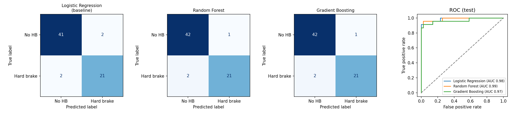

최종 모델은 Test 66개 중 3개를 틀렸습니다(급제동을 놓친 것 2개, 잘못 경고한 것 1개).

### 학습곡선 (Gradient Boosting)

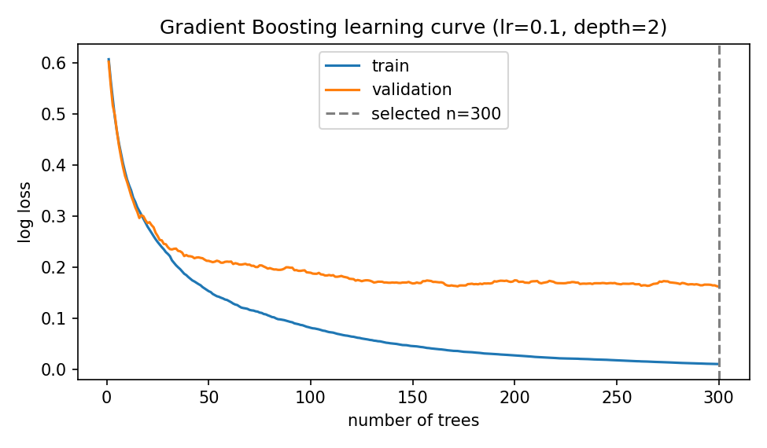

### 특징 중요도

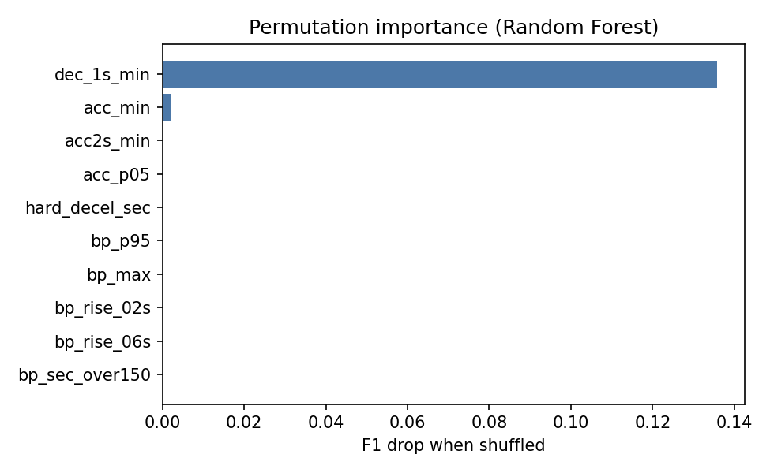

최종 모델은 `dec_1s_min`(0.2초 단위 시계열에서 계산한 1초 구간 최대 감속)에 가장 크게 의존합니다.

### 오류 사례

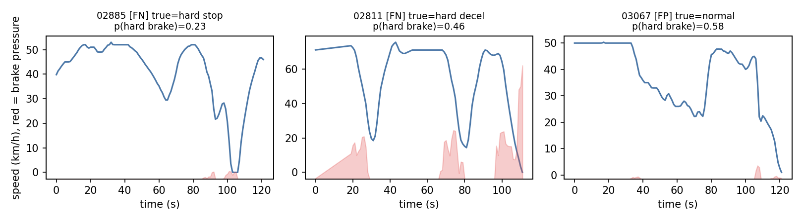

| 클립 | 실제 | 예측 확률 | 유형 | 원인 분석 |
|---|---|---|---|---|
| 02885 | 급정지 | 0.226 | 놓침 | 최대 감속 -2.58m/s², 브레이크 압력 14로 센서상으로는 부드러운 정지와 구분되지 않음 |
| 02811 | 급감속 | 0.463 | 놓침 | 브레이크 압력은 206으로 높지만 감속이 -2.73m/s²에 그침. 기록이 18초 끊겼던 클립 |
| 03067 | 일반 | 0.582 | 오경보 | 감속은 -3.59m/s²로 컸지만 브레이크 압력은 24. 엔진 브레이크나 오르막 감속으로 추정 |

저속에서 일어나는 급정지는 속도 변화량이 작아 잘 놓칩니다.

### 실제 도로 클립에 적용 (정답 없음)

정답이 없는 실제 도로 클립 2,317개에 세 모델을 적용했습니다.

| 모델 | 급제동으로 판정한 비율 |
|---|---|
| Logistic Regression | 9.0% (209개) |
| **Random Forest (최종)** | **1.8% (42개)** |
| Gradient Boosting | 5.4% (124개) |

최종 모델이 판정한 42개 클립의 최대 감속 중앙값은 -4.13m/s²로, 테스트 도로의 급제동 클립(-4.28m/s²)과 비슷했습니다. 판정되지 않은 클립은 -1.71m/s²였습니다.

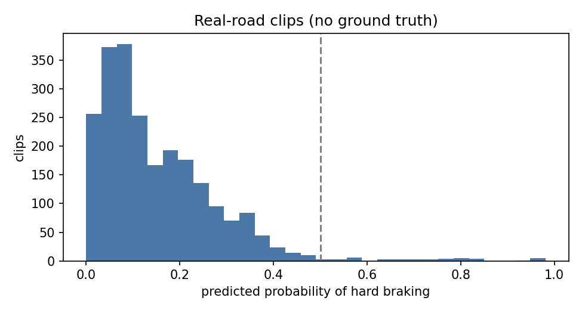

## 6. 서비스 프로토타입

### 모델 연동 방식

```
브라우저 ──(CAN JSON 업로드)──▶ FastAPI 서버
                                   │ 1. 입력 검증
                                   │ 2. 전처리 (학습 때와 같은 app/features.py)
                                   │ 3. 특징 19개 계산
                                   │ 4. models/hard_braking_model.joblib 로 예측
브라우저 ◀──(확률, 요약, 시계열)──┘
```

- 서버가 시작될 때 Colab에서 직접 학습한 모델 파일 [`models/hard_braking_model.joblib`](models/hard_braking_model.joblib)을 한 번 읽어 두고, 요청마다 그 모델로 예측합니다. 외부 AI API는 쓰지 않습니다.
- 전처리와 특징 계산은 노트북과 같은 코드를 씁니다. 실제 테스트 도로 클립 25개로 서비스와 노트북의 예측 확률이 일치하는 것을 확인했습니다.

| API | 설명 |
|---|---|
| `POST /api/predict` | CAN JSON 파일을 받아 급제동 확률을 돌려줌 |
| `POST /api/predict-sample/{id}` | 저장소의 예시 파일로 예측 |
| `GET /api/samples` | 예시 목록 |
| `GET /api/model` | 모델 이름과 평가 지표 |
| `GET /api/health` | 서버 상태 |

### 사용 방법

1. 데모 주소에 접속합니다.
2. **예시 주행** 세 개 중 하나를 누르거나, **내 CAN JSON 파일**을 올립니다.
3. 급제동 확률, 가장 센 감속, 속도·브레이크 그래프를 확인합니다. 확률이 50% 이상이면 급제동으로 판정합니다.

예시 주행은 AI Hub 원본이 아니라 같은 파일 형식으로 직접 만든 합성 데이터입니다([`scripts/make_samples.py`](scripts/make_samples.py)).

### 화면 캡처

**첫 화면**

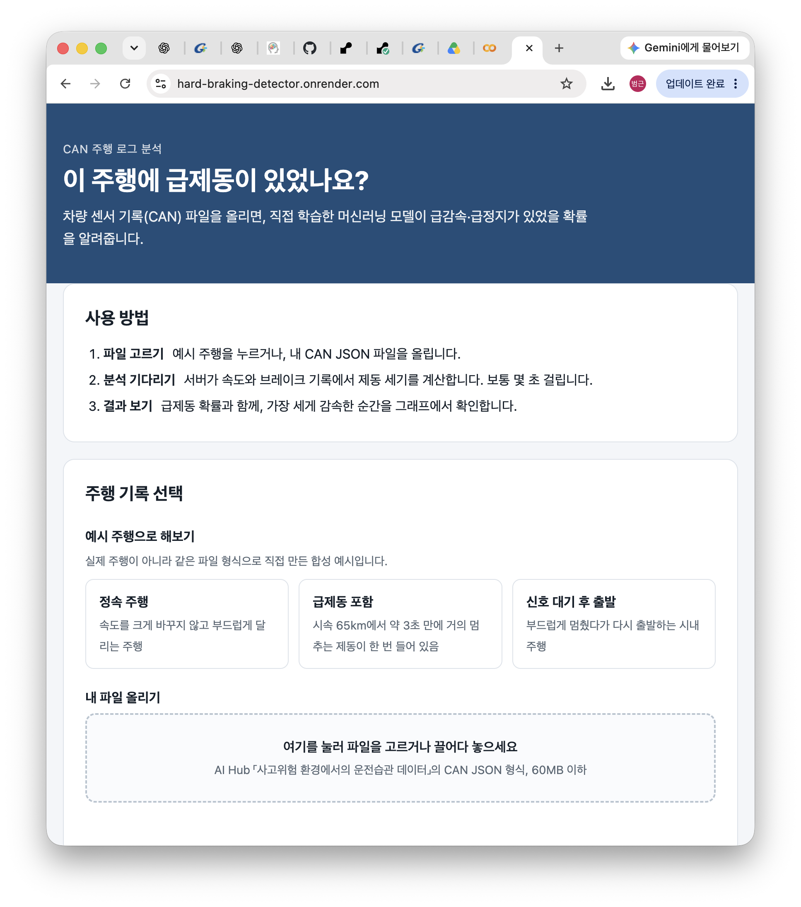

**분석 결과 (급제동 포함 예시)**

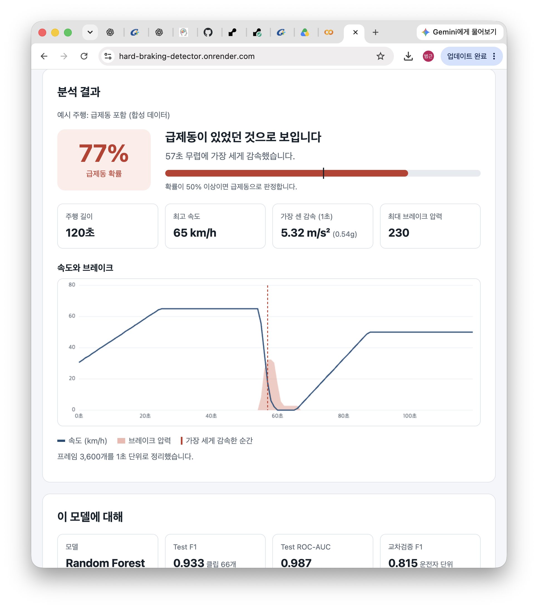

**잘못된 파일을 올렸을 때**

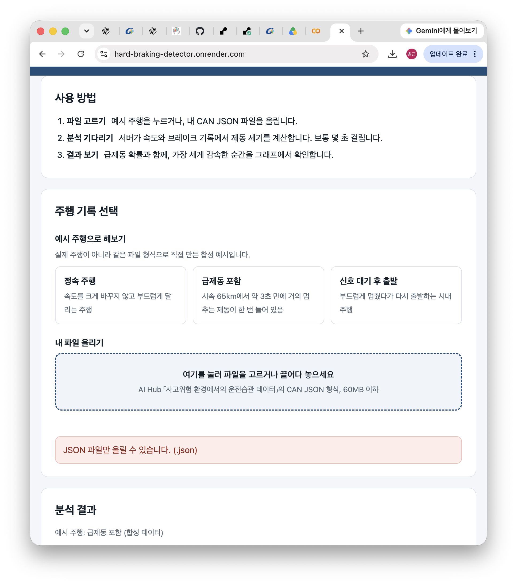

### 잘못된 입력 처리

| 입력 | 안내 문구 |
|---|---|
| JSON이 아닌 확장자 | JSON 파일만 올릴 수 있습니다. |
| 빈 파일 | 빈 파일입니다. CAN JSON 파일을 올려주세요. |
| 깨진 JSON | JSON 형식이 올바르지 않습니다. |
| `frames`가 없는 JSON | CAN 파일 형식이 아닙니다. |
| 필요한 센서 값이 빠진 프레임 | 몇 번째 프레임에 어떤 값이 없는지 안내 |
| 숫자가 아닌 센서 값 | 시각·속도·RPM·브레이크 값에 숫자가 아닌 항목이 있습니다. |
| 10초 미만의 기록 | 10초 이상이어야 분석할 수 있습니다. |
| 60MB 초과 | 파일이 너무 큽니다. |

## 7. 배포

| 항목 | 내용 |
|---|---|
| 플랫폼 | Render (Web Service, Free) |
| 공개 URL | https://hard-braking-detector.onrender.com |
| 지역 | Singapore |
| 실행 환경 | Python 3.11.9 |
| 빌드 명령 | `pip install -r requirements.txt` |
| 시작 명령 | `uvicorn app.main:app --host 0.0.0.0 --port $PORT` |
| 배포 방식 | GitHub `main` 브랜치에 푸시하면 자동 배포 |

화면(HTML·CSS·JS)과 API를 FastAPI 서버 하나가 함께 제공합니다. 배포 대상과 공개 주소가 하나라 설정이 단순하고, 화면과 API 사이의 교차 출처 문제가 없습니다.

## 8. 실행 방법

### 실행 환경

| 구분 | 환경 |
|---|---|
| 서비스 | Python 3.11, FastAPI 0.115.6, scikit-learn 1.6.1, numpy 2.0.2, pandas 2.2.3 |
| 학습 (Colab) | Python 3.13.18, scikit-learn 1.6.1, numpy 2.4.6, pandas 2.2.3, CPU 런타임 |

모델 파일은 scikit-learn 1.6.1에서 저장했습니다. 다른 버전에서는 불러올 때 오류가 날 수 있어 `requirements.txt`에 버전을 고정했습니다.

### 서비스 실행

```bash
git clone https://github.com/bumgeum01-stack/hard-braking-detector.git
cd hard-braking-detector
python3 -m venv .venv
source .venv/bin/activate
pip install -r requirements.txt
uvicorn app.main:app --reload
```

브라우저에서 `http://127.0.0.1:8000`을 엽니다.

### 모델 가중치 위치

| 파일 | 설명 |
|---|---|
| [`models/hard_braking_model.joblib`](models/hard_braking_model.joblib) | 최종 모델 (Random Forest, 약 0.96MB) |
| [`models/model_meta.json`](models/model_meta.json) | 특징 목록, 판정 기준, 평가 지표 |

### 학습 재현

1. AI Hub에서 「사고위험 환경에서의 운전습관 데이터」를 내려받습니다.
2. 구글 드라이브에 `ml-final/data` 폴더를 만들고 Training의 라벨 zip 5개와 CAN zip을 압축을 풀지 않은 채 올립니다.
3. [`notebooks/hard_braking_colab.ipynb`](notebooks/hard_braking_colab.ipynb)를 Colab에서 열어 **모두 실행**합니다. GPU는 필요 없습니다.
4. 결과는 드라이브의 `ml-final/outputs`에 저장됩니다.

### 저장소 구성

```
app/            FastAPI 서버, 전처리·특징 코드, 화면
models/         학습한 모델과 메타 정보
notebooks/      학습 노트북 (출력 포함)
results/        학습 로그, 지표 비교표, 오류 사례
samples/        데모용 합성 예시 파일
scripts/        합성 예시 생성 코드
docs/           README용 그래프와 화면 캡처
```

## 9. Lessons Learned

### PMI

**Plus (잘한 점)**

1. **데이터를 먼저 열어보고 주제를 바꿨습니다.** 처음 계획은 "운전 습관으로 미래 사고 확률 예측"이었지만, 라벨 2,640개를 전부 표로 만들어 보니 사고 여부 정답이 없었습니다. 억지로 정답을 만들지 않고, 사람이 표기한 급거동 정답이 실제로 있는 문제로 바꿨습니다.
2. **운전자 단위로 나누고 평가했습니다.** 같은 운전자의 클립이 학습과 평가에 섞이지 않게 분할했고, 겹치는 운전자가 0명인지 코드로 확인했습니다. 최종 모델도 운전자 한 명씩 빼는 교차검증으로 골랐습니다.
3. **학습과 서비스가 같은 전처리 코드를 씁니다.** 실제 클립 25개로 서비스의 예측 확률이 노트북과 일치하는 것을 확인했습니다.

**Minus (아쉬운 점)**

1. **평가 데이터가 작습니다.** Test는 운전자 3명, 클립 66개입니다. 분할 방식을 바꿔 본 과정에서 Test F1이 0.82에서 0.96까지 움직였습니다. 그래서 Test 수치와 함께 교차검증 F1(0.815)을 같이 적었습니다.
2. **급정지를 잘 놓칩니다.** 저속에서의 급정지는 속도 변화량이 작아 부드러운 정지와 센서상으로 구분되지 않는 경우가 있었습니다.
3. **실제 도로에서의 정확도를 검증하지 못했습니다.** 실제 도로 클립에는 급제동 정답이 없어서 탐지 비율과 감속 세기만 확인했습니다.

**Interesting (흥미로웠던 점)**

1. **Test 점수가 높아도 엉뚱한 것을 배운 모델일 수 있었습니다.** 급출발까지 정답에 넣은 비교용 모델은 Test F1이 0.898로 좋아 보였지만, 실제 도로 클립의 61.8%를 위험으로 판정했습니다(아래 문제 해결 사례).
2. **공개 데이터의 센서 값이 깨져 있었습니다.** 가속도·자이로 값이 -400 부근과 0 부근 두 덩어리로 갈라지고 -4088, 65399 같은 값이 섞여 있어 쓰지 못했습니다. 대신 0.2초 단위 속도 변화와 브레이크 압력으로 제동 세기를 계산했습니다.
3. **같은 코드인데 환경에 따라 데이터가 다르게 나뉘었습니다.** 처음 쓴 라이브러리 분할 함수가 버전에 따라 다른 결과를 내서, 한 환경에서는 Train 180개였던 것이 Colab에서는 76개가 됐습니다.

### 문제 해결 사례: 지름길 학습

| 단계 | 내용 |
|---|---|
| **문제** | 급감속·급정지·급출발·급가속을 모두 "위험 거동"으로 묶어 학습한 모델이 Test에서는 F1 0.898로 좋았는데, 정답이 없는 실제 도로 클립 2,317개에 적용하니 61.8%를 위험으로 판정했습니다. 판정된 클립의 최대 감속 중앙값은 -1.74m/s²로 평범한 주행이었습니다. |
| **원인** | 특징 중요도를 보니 "정지 상태에서 3초간 올린 속도"가 1위(0.29)였습니다. 테스트 도로의 일반 클립은 대부분 정지 없이 계속 달리는 주행이고 급출발 클립은 정지 상태에서 출발합니다. 모델이 "정지했다 출발한 적이 있으면 위험"이라는 지름길을 배운 것입니다. 실제 도로에서는 신호 대기 후 출발이 흔하므로 대부분이 걸렸습니다. |
| **시도** | ① 정지 비율·출발 세기 같은 맥락 특징을 제거했습니다. ② 급출발 클립의 출발 세기가 실제 도로의 평범한 출발과 겹쳐 세기로 구분되지 않는 것을 확인하고, 정답을 물리적 세기로 드러나는 급제동(급감속·급정지)으로 좁혔습니다. ③ 특징을 감속도와 브레이크 압력에 관한 것으로만 다시 설계하고, 순간적인 제동을 잡기 위해 0.2초 단위 시계열을 추가했습니다. |
| **결과** | 최종 모델은 Test F1 0.933이고 실제 도로 탐지 비율은 1.8%입니다. 판정된 클립의 최대 감속 중앙값은 -4.13m/s²로 테스트 도로의 급제동 클립(-4.28m/s²)과 비슷합니다. 이 비교는 노트북 11-1에 재현 실험으로 남겼습니다. |

### 향후 개선 계획

| 측면 | 계획 |
|---|---|
| **데이터** | ① 실제 도로 클립 중 모델이 높은 확률을 준 것부터 영상을 확인해 급제동 여부를 직접 표기하고, 실제 도로에서의 정확도를 측정합니다. ② 저속 급정지 사례를 더 모아 약한 유형을 보강합니다. |
| **모델** | ① 클립 전체가 아니라 5~10초 구간 단위로 판정해 "언제" 급제동이 있었는지를 모델이 직접 출력하게 합니다. ② 1차원 CNN처럼 시계열을 그대로 입력받는 모델과 비교합니다. ③ 판정 기준(현재 50%)을 놓침과 오경보의 비용에 맞춰 조정합니다. |
| **서비스** | ① 여러 주행 파일을 한 번에 올려 운전자별 급제동 빈도를 요약합니다. ② 무료 서버가 잠드는 문제를 줄이기 위해 주기적으로 상태 확인 요청을 보내거나 유료 인스턴스로 옮깁니다. ③ AI Hub 형식 외에 일반적인 CSV 주행 기록도 받을 수 있게 합니다. |
